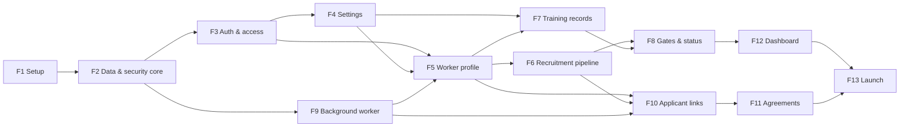

# Features and dependency map

Use this before any change: find the feature, check **Used by** — those features may break or need re-testing. Each feature gets its own doc (copy `_TEMPLATE.md`) when work on it starts.

Status: `planned` · `designing` · `building` · `done` · `phase 2` · `phase 3`

## Phase 1

| # | Feature | Doc | Status | Depends on | Used by |
| --- | --- | --- | --- | --- | --- |
| F1 | Project setup and tooling | `project-setup.md` | building | – | all |
| F2 | Data and security core (schema base, RLS, `withUser()`, audit, soft delete) | `data-security-core.md` | planned | F1 | all data features |
| F3 | Auth and access (login, 2FA, sessions, roles, branches, switcher, users) | `auth-access.md` | planned | F2 | all screens |
| F4 | Settings (branches, document types, training courses) | `settings.md` | planned | F3 | F5, F7, F14, F15 |
| F5 | Worker profile and documents | `worker-profile.md` | planned | F3, F4, F9 | F6, F7, F10, F11, F12, F16, F17 |
| F6 | Recruitment pipeline (16 stages, dependencies, date rules, overrides) | `recruitment-pipeline.md` | planned | F5 | F8, F12, F18 |
| F7 | Induction, training, shadowing, competency records | `training-records.md` | planned | F4, F5 | F8, F15, F18 |
| F8 | Gates and compliance status | `gates-compliance.md` | planned | F6, F7 | F12, F14, F18 |
| F9 | Background worker (queue, virus scan, link expiry, backups) | `background-worker.md` | planned | F2 | F5, F10, F14, F20 |
| F10 | Applicant links, application form, Pending review, email | `applicant-links.md` | planned | F5, F6, F9 | F11, F14 |
| F11 | Agreements and paper signatures | `agreements.md` | planned | F5, F10 | F6 (stage 10), F18 |
| F12 | Dashboard, search, worker history, transfers | `dashboard.md` | planned | F2, F8 | F19 |
| F13 | Hardening and beta launch | `launch.md` | planned | F1–F12 | – |

## Phase 2 and 3 (not being built yet)

| # | Feature | Phase | Depends on |
| --- | --- | --- | --- |
| F14 | Renewals and reminders | 2 | F8, F9, F10 |
| F15 | Training matrix | 2 | F7 |
| F16 | Supervisions, appraisals, spot checks | 2 | F5 |
| F17 | Confidential notes and leavers | 2 | F5 |
| F18 | CQC worker file with one-click PDF | 2 | F6, F7, F8, F11 |
| F19 | Audit search, reports, CSV exports | 2 | F2, F12 |
| F20 | Bin screen, restore, 30-day removal | 2 | F2, F9 |
| F21 | Three fixed templates | 2 | F5 |
| F22 | Staff data migration | 2 | F5–F8 |
| F23 | Smart date reading | 3 | F5, F10 |
| F24 | DBS scan with auto-deletion | 3 | F8, F9 |
| F25 | SMS and daily summary | 3 | F9, F10 |
| F26 | Template editor and settings screens | 3 | F21 |
| F27 | E-signatures | 3 | F10, F11 |
| F28 | AI assistant | 3 | all |

## Phase 1 dependency graph

## Shared foundations (changes here affect everything)
`withUser()`, `can()` and the role → permission map, RLS helper functions, the audit trigger, soft delete, the `worker` and `document` tables, storage buckets, and the secure link machinery. Changes to any of these need the `architect` and `db-rls-reviewer` agents and a full test run.
